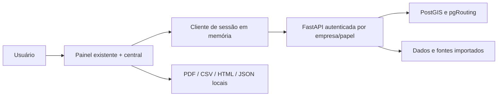

# Onboarding técnico, arquitetura e operação

## Onboarding de cliente

1. Definir corredor, malha coberta e fontes com os responsáveis por dados/rotas. A consulta de corredor de referência não é cadastro persistido do cliente.
2. Provisionar empresa e usuários no backend. O login demonstrativo não ativa uma empresa real; aguardar identidade/recuperação e administração antes de produção.
3. Cadastrar frota e medidas efetivas com carga. Validar consumo/custos e fontes; não inferir capacidade de ponte pelo tipo de caminhão.
4. Receber rotas no modelo JSON da central. Coordenadas numéricas, nome de origem/destino e janela ISO com fuso são obrigatórios. Medidas opcionais exigem as cinco dimensões; custos não podem ser negativos.
5. Validar arquivo, conferir empresa e identificadores, importar e tratar falhas por item. Em erro incerto, consultar cadastros antes de reenviar. Guardar arquivos do cliente em local autorizado; não anexar rotas privadas a issues públicas.
6. Conferir primeiro resultado: rota, limitações, fontes, alternativa e custos. Registrar decisão e exportar relatório. Sem dados de execução, classificar benefício como estimado/potencial.
7. Medir onboarding: a central mostra tempo local até carregar um relatório. O evento persistente de primeiro resultado útil depende do backend e não está concluído por esse contador.

## Arquitetura

`b2b.html` mantém os fluxos operacionais. `painel-sessao.js` centraliza transporte, papéis, cancelamento e falhas. `portal-operacional.js` implementa navegação e consultas da central; `portal-dados.js` valida importação e prepara formatos; `portal-pdf.js` gera texto PDF paginado; `painel-acessibilidade.js` complementa teclado/rótulos/sugestões/camadas. Não há motor financeiro ou de rotas novo no frontend.

Fontes e limitações: [documentação de fontes](documentacao_fontes.md), [dados de riscos/combustíveis](dados-riscos-combustiveis.md), [integração de custos](integracao-dados-viagem.md) e endpoints de fontes/qualidade. As frequências dessas fontes diferem; dados importados, históricos, previsão, observação e simulação têm naturezas distintas. O estado do endpoint de qualidade não homologa cobertura, passagem de caminhão ou atualidade de uma tarifa.

## Procedimentos operacionais — revisão conjunta necessária

Estes passos complementam os scripts existentes; devem ser revisados com o responsável de infraestrutura e executados no ambiente correto. Não representam homologação de produção ou restauração já realizada nesta entrega.

**Deploy:** registrar commit/imagem atual, verificar backup e migrations, executar CI e revisão cruzada; construir a nova imagem; aplicar somente migrations aprovadas; subir API; executar `scripts/check_deploy.ps1`/readiness no ambiente configurado; conferir login, empresa, operação, decisão e relatório. Monitorar erros e fontes. Nunca apontar a suíte de testes que altera eventos ao banco operacional.

**Rollback:** preservar backup e evidências; voltar à imagem/commit anterior aprovado; confirmar compatibilidade do esquema antes da troca; subir e verificar readiness e fluxos. Se houve migration incompatível, seguir plano de restauração aprovado pelo responsável. Não apagar volumes como rollback.

**Backup/restauração:** seguir [backup-restauracao-postgis.md](backup-restauracao-postgis.md). O script `scripts/postgres_backup.py` faz backup e restaura em banco novo, sem substituir o banco original. Validar hash, estrutura e consulta no banco restaurado antes de qualquer troca de aplicação. Registrar duração e resultado do teste real.

**Incidente:** registrar horário/commit/sintoma/escopo; restringir ou revogar credenciais afetadas pelo mecanismo do backend; preservar logs com acesso controlado, sem publicar segredos; isolar a instância afetada sem destruir dados; avaliar restauração/rollback com infraestrutura; validar isolamento de empresas e comunicar ao responsável. Falha de fonte deve aparecer como indisponibilidade, nunca como ausência de risco.

**Saída de webhooks:** o envio conecta diretamente ao IP público validado no
momento da requisição, sem seguir redirecionamentos ou usar proxy de ambiente.
Em HTTPS, o certificado continua sendo verificado contra o nome original.
Se o ambiente exigir proxy de saída, configure um gateway que preserve essa
validação antes de ativar webhooks externos.

## Testes e revisão

`npm ci --ignore-scripts --no-audit --no-fund && npm test` executa testes de sessão, normalização, geração de PDF/CSV e fluxos DOM da central. A suíte Python e contratos de importação exigem banco isolado. A inspeção manual deve incluir desktop/mobile, teclado, troca de sessão, arquivos inválidos e resultados parciais.

Faltam revisão independente em máquina limpa, revisão conjunta dos procedimentos, prova de restauração/deploy/rollback e suíte completa de navegador para todos os fluxos do MVP. Marcar esses itens somente após evidência, conforme o [checklist](checklist-interface.md).
